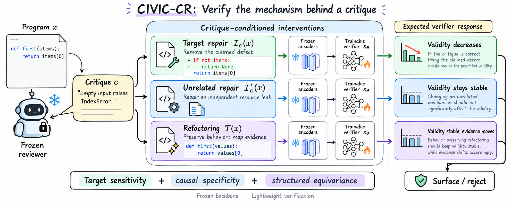

<div align="center">

# CIVIC-CR

### Causal Intervention Verification for Critique Reliability in Code Review

**Does a review critique track the defect it claims to identify?**

[Method](#method) · [Code](#code) · [Getting started](#getting-started) · [Reproducibility](docs/REPRODUCIBILITY.md)


</div>



CIVIC-CR studies verification of AI-generated code-review findings through **critique-conditioned program interventions**. A convincing explanation alone does not establish that a defect exists. We instead ask whether a finding responds to changes in the specific mechanism it alleges.

The repository contains research scripts for frozen embeddings, lightweight verification, intervention ranking, controlled evaluations, and downstream repair experiments. The figure illustrates the research design; individual scripts implement subsets of it. No conference acceptance, released paper, or fully reproduced result is claimed here.

## Method

For a program `x` and a candidate critique `c`, the verifier produces a validity score `sθ(x, c)`. Three complementary checks characterize the intended behavior:

| Check | Intervention | Expected response |
| :--- | :--- | :--- |
| Target sensitivity | Repair the defect claimed by `c` | The critique's validity decreases |
| Causal specificity | Repair an unrelated mechanism | The critique's validity stays stable |
| Structured equivariance | Apply a behavior-preserving transformation | Validity stays stable; location and evidence move consistently |

The key contrast is between `sθ(x,c) − sθ(I_c(x),c)` and the score change under an unrelated intervention. The reviewer, intervention generator, and embedding backbone remain frozen; the upper verifier and intervention ranker are trained.

A typical failure case is a null-dereference warning on code that already has a dominating null guard. A redundant edit should not become evidence that the original warning was correct. Intervention quality and executable validation are therefore part of the evaluation assumptions.

## Code

```text
phaseC/        Frozen embeddings, shared verifier models, early baselines and diagnostics
phaseE/        Critique construction, three-arm repair harness, executable checks
phaseF/        Main training, ablations, generalization and benchmark experiments
assets/        Method overview
docs/         Reproducibility and release notes
```

| Entry point | Purpose |
| :--- | :--- |
| `phaseC/model.py` | MLP, bilinear, and Transformer-based verifier definitions |
| `phaseF/build_emb_diff.py` | Build aligned code/critique embeddings from intervention data |
| `phaseF/train_civic.py` | Joint classification, sensitivity, specificity, and ranking training |
| `phaseF/quad_eseries.py` | Five intervention-objective configurations across three seeds |
| `phaseF/frozen_reviewer_baseline.py` | Frozen LLM reviewer evaluation |
| `phaseF/e4_equivariance.py`, `phaseF/e4_loc.py` | Transformation and localization evaluations |
| `phaseF/e6_min.py` | Leave-project-out evaluation |
| `phaseE/spike_repair.py`, `phaseF/e8_downstream.py` | Repair harness and downstream aggregation |

## Getting started

Use Python 3.10 or newer. Run commands from the repository root.

```bash
python -m venv .venv
source .venv/bin/activate
pip install -r requirements.txt
export CIVIC_PROJECT_ROOT="$PWD"
mkdir -p cache data repos_cache experiments/preexp_anchor0
python phaseF/train_civic.py --help
```

The training scripts require external benchmark data and precomputed artifacts. **This checkout does not include datasets, intervention quadruples, split manifests, embeddings, checkpoints, or experimental outputs.** Installation alone is insufficient to reproduce the experiments. See [the required inputs and known limitations](docs/REPRODUCIBILITY.md).

With those artifacts prepared:

```bash
python phaseF/build_emb_diff.py
python phaseF/embed_benchmarks.py --bench aacr
python phaseF/train_civic.py --seed 42
python phaseF/quad_eseries.py
```

### Optional model services

Embedding and verifier training can run locally with downloaded backbone weights. LLM-based construction and review scripts additionally require your own service credentials. The variable names are listed in [.env.example](.env.example); scripts read the process environment and do not automatically load that file. Set `OPENAI_BASE_URL` and `OPENAI_API_KEY` for OpenAI-compatible calls, or `ANTHROPIC_BASE_URL` and `ANTHROPIC_API_KEY` for Anthropic calls. Azure embedding experiments use their own endpoint and key variables.

Some historical scripts select fixed model identifiers or service-specific API methods. Check the selected script and your provider's support before a paid run. Repair experiments also require Docker, benchmark images, and suitable compute.

## Evaluation scope

The research questions cover false positives at matched defect recall, target-versus-unrelated intervention discrimination, transformation consistency, generalization, intervention ranking, and downstream repair utility. Pair AUROC measures intervention discrimination; it is not interchangeable with finding-validity AUROC.

Causal evidence depends on an intervention actually removing the alleged defect without introducing confounding changes. Subjective review comments and unfixable findings may not support this test. The repository retains exploratory and negative-result scripts; no performance table is published without accompanying artifacts.

## Release notes

See [release validation](docs/RELEASE_NOTES.md) for the checks performed and [reproducibility](docs/REPRODUCIBILITY.md) for implementation caveats. This repository currently has no license grant; redistribution and reuse permissions require clarification from the rights holder. Third-party benchmarks and model weights retain their own terms.
