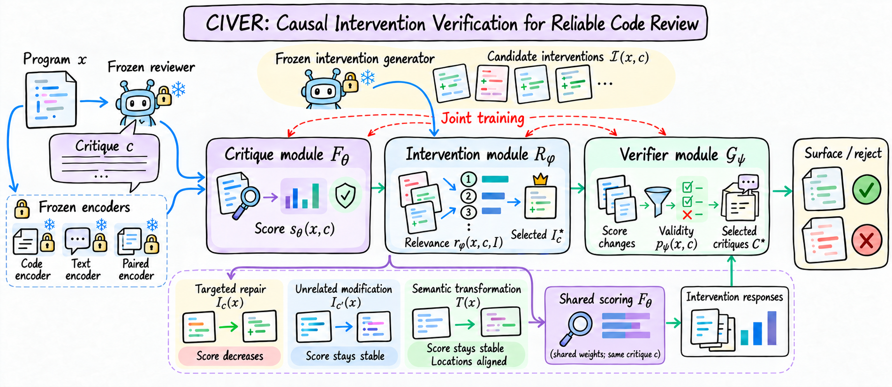

<h1 align="center">CIVER</h1>

<p align="center"><strong>Causal Intervention Verification for Reliable Code Review</strong></p>

<p align="center">
  <a href="https://www.python.org/"></a>
  <a href="https://pytorch.org/"></a>
</p>

CIVER checks whether a code-review critique identifies a real defect by comparing its validity score across controlled program changes. Removing the claimed defect should lower the score, while unrelated edits and semantics-preserving transformations should leave it stable. Three jointly trained modules rank candidate interventions, score the same critique across program states, and combine these responses to verify critiques and select nonredundant findings.



## Framework

Three lightweight modules are jointly optimized over frozen code, critique, and code–critique representations.

| Module | Parameters | Role |
| --- | --- | --- |
| Critique module | $F_\theta$ | Score the same critique across program states with shared cross-attention and a scoring MLP. |
| Intervention module | $R_\phi$ | Estimate candidate relevance and select a defect-related intervention. |
| Verifier module | $G_\psi$ | Combine the original score with intervention responses to estimate validity and select a critique subset. |

The reviewer, representation encoders, and intervention generator remain frozen. Training uses relevance-weighted candidate responses so that gradients reach all three modules; inference selects the highest-ranked intervention. Token features additionally support location and supporting-context predictions. Pooled features represent one context position and do not provide source-line localization.

## Training objectives

| Objective | Purpose |
| --- | --- |
| Critique validity | Supervise the verifier's final validity probability. |
| Defect removal | Reduce the critique score after a verified targeted repair. |
| Unrelated modification | Preserve the score under changes unrelated to the claim. |
| Semantic transformation | Preserve validity and align location and supporting-context distributions through explicit transformation maps. |
| Intervention ranking | Assign higher relevance to verified targeted repairs. |
| Intervention minimality | Prefer smaller verified repairs using actual edit costs, without rewarding no-op or unverified candidates. |
| Review selection | Learn a validity-supervised gate with review-size and redundancy penalties. |

The modules expose separate parameter groups for joint optimization. Loss weights and training settings are configured in the training code and command-line interface. Verified bug-inducing interventions also supervise stale critiques on repaired programs. Missing controls, edit measurements, and structural annotations use explicit availability masks; they do not become fabricated observations. Subset selection supports exact and greedy inference.

## Getting started

Run commands from the repository root:

```bash
python -m venv .venv
source .venv/bin/activate
pip install -r requirements.txt
pip install -e ".[test]"
python -m scripts.train_full --help
```

After preparing the frozen feature arrays:

```bash
python -m scripts.train_full \
  --data data/joint_features.npz \
  --output outputs/joint
```

The full trainer keeps complete review groups together, checks the declared split unit, and selects a checkpoint using validation AUROC, validation intervention discrimination, and validation loss. Thresholds are calibrated on validation findings. It saves initial, final, and selected weights, per-module gradient checks, source hashes, and objective histories. Dense test curves are stored separately as exploratory diagnostics and never select the reported checkpoint. The original `train_joint` entry point remains available for its validation-loss protocol.

An optional identity candidate represents abstention using the measured original program and a zero edit cost. It is appended uniformly, is never a verified repair or an unrelated control, and cannot satisfy repair supervision. Validation plateaus can stop training before the configured maximum; each run records the actual number of completed epochs.

The trainer can balance classification and intervention discrimination with a joint validation criterion. When human locations are unavailable, optional repair-span supervision is recorded explicitly as a weak proxy. Exact copies of a finding are removed before the formal split is evaluated; multiple program-state views do not count as additional review comments.

## Finding filtering

`python -m scripts.train_finding_filter --help` exposes reviewer-anchored adaptation of the complete three-module model. It supports separate module learning rates, explicit dropout-only checkpoint transfer, residual regularization, class-balanced supervision, and training-only ordering losses. The frozen reviewer score must be available for every finding. Supply real PR identifiers in the feature archive or an explicit case-to-PR mapping so workload metrics retain the full PR denominator.

An optional confidence input lets the verifier condition its learned correction on the frozen reviewer score. Explicit checkpoint expansion initializes the added connections to zero; earlier configurations retain their original behavior.

Decision thresholds are calibrated on validation data. Fixed-recall evaluation uses a held-out score curve and is recorded separately from deployment thresholds. Each exploratory metric winner retains its actual weights, predictions, epoch, and source hashes; different metrics may select different epochs. These test-selected diagnostics never replace the validation-selected checkpoint or the original validation references.

## Data interface

The joint trainer accepts an NPZ archive with the following arrays:

| Arrays | Content |
| --- | --- |
| `original`, `critique` | Frozen code and critique features. |
| `candidates` | Candidate targeted-intervention features for each critique. |
| `unrelated`, `transformed` | Corresponding control states, shared or supplied per candidate. |
| `pair_original`, `pair_candidates`, `pair_unrelated`, `pair_transformed` | Separate frozen code–critique representations for every program state. |
| `labels` | Critique-validity labels. |
| `target_index` | Verified target-candidate index, or `-1` when unannotated. |
| `group_id` | Review membership at a single program state for nonredundant set selection. |
| `split` | Prespecified `train`, `val`, and optional `test` assignments. |
| `candidate_mask` | Optional mask for valid candidate entries. |
| `case_id`, `repo`, `pair_id`, `pr_id` | Stable provenance, grouping, and evaluation identifiers. |
| `candidate_edit_costs`, `candidate_edit_cost_mask` | Measured code-edit sizes and their availability. |
| `candidate_verified_mask`, `reverse_index`, `reverse_verified_mask` | Loss-only repair and bug-inducing annotations. |
| `original_mask`, `candidate_token_mask`, control and paired masks | Valid feature positions, excluding padding. |
| `transformed_critique`, `transformed_location_map`, `transformed_support_map` | Transformed critique features and old-to-new position maps. |
| `location_labels`, `support_labels`, supervision and mapping masks | Available structural annotations; weak proxies must be distinguished from gold labels. |

Code, critique, and paired representations may be pooled vectors or fixed-length token features with padding masks. Each available program state requires its own paired representation. All findings and counterfactual derivatives from a review or issue stay in one split. Ground-truth validity, target indices, verified-repair masks, and location annotations enter losses only; they are excluded from the model's prediction inputs.

Transformed states must be supplied rather than replaced by a zero loss. Identical original/control representations are reported as data diagnostics and cannot establish a response to a distinct intervention.

## Repository layout

```text
civic/       Trainable modules, joint objectives, paths, and optional service adapters
scripts/     Joint training, evaluation, ablations, and executable repair experiments
tools/       Dataset construction, frozen features, and diagnostics
env/         Dependencies and an empty local configuration template
assets/      Framework figure
tests/       Offline checks of gradients, objectives, selection, and training
```

| Entry point | Purpose |
| --- | --- |
| `civic/models.py` | Shared critique scorer, response verifier, and complete CIVER model. |
| `civic/ranking.py` | Intervention relevance and critique-subset selection. |
| `civic/objectives.py` | Seven joint training objectives. |
| `civic/evaluation.py` | Classification, actual-control intervention, retrieval, and mapped-transformation metrics. |
| `scripts/train_full.py` | Audited three-module training and validation-selected evaluation. |
| `scripts/train_finding_filter.py` | Reviewer-anchored finding filtering with independent metric records and explicit threshold policies. |
| `scripts/train_classifier_baseline.py` | Train and evaluate an MLP on the same frozen code, critique, and paired features. |
| `scripts/train_retrieval.py` | Adapt intervention retrieval from a fully trained three-module checkpoint using separate training and validation candidate pools. |
| `scripts/train_joint.py` | Joint training with separate module parameter groups. |
| `scripts/train_civic.py` | Original verifier–ranker experiment entry point. |
| `scripts/evaluate_matched_pairs.py` | Defective–repaired pair evaluation. |
| `scripts/evaluate_equivariance.py` | Transformation consistency evaluation. |
| `scripts/evaluate_finding_baselines.py` | Finding-validity baselines. |
| `scripts/evaluate_reviewer_cross_language.py` | Reviewer evaluation across languages. |
| `scripts/evaluate_ranking_baselines.py` | Intervention-retrieval baselines. |
| `scripts/evaluate_repair_controls.py` | Controlled downstream repair experiments. |

The `civic` import namespace and original training and evaluation workflows remain available. The original verifier–ranker trainer retains its historical behavior. Use `train_full` with reconstructed source states and measured controls for the full experimental protocol. Historical simplified-model results are not results of the expanded three-module implementation.

The retrieval trainer starts from a checkpoint whose three modules have already been trained. It retains the critique and verifier modules and adapts the intervention module to actual patch-text representations. Its selected checkpoint is used for retrieval; the joint-training checkpoint remains the source for classification and downstream selection.

## Verification

```bash
python -m pytest -q
```

The offline checks cover the training graph, module gradients, state inputs, candidate masks, exact subset selection, and validation-based checkpointing. They verify the implementation and do not regenerate benchmark scores.
