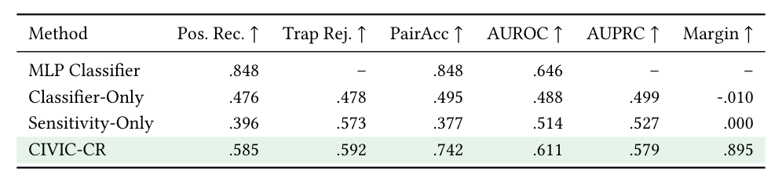
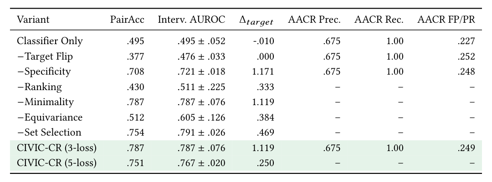
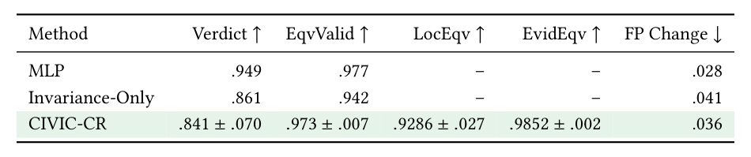
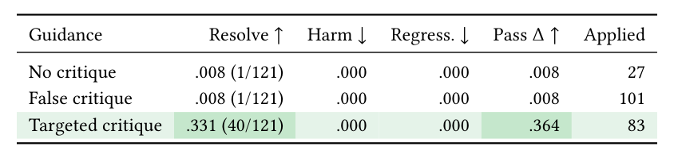
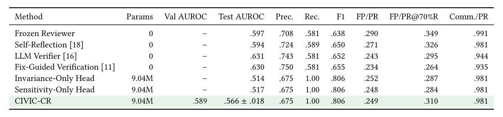
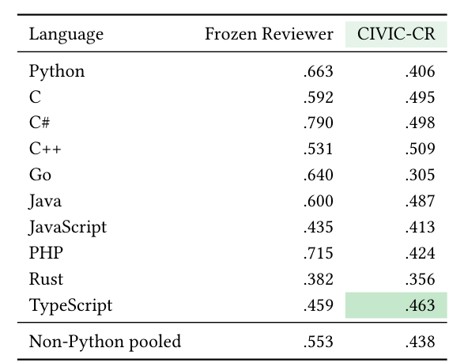

# Results tables

These tables replace the former bar charts. Pale green identifies CIVIC-CR or the targeted-guidance condition; darker green marks a favorable measured comparison. A green row does not imply the best value in every column. Reported numbers and uncertainty ranges are unchanged. Values from different cohorts or operating points describe separate evaluations.

## Matched-pair discrimination

Held-out executable bug–safe pairs evaluate the same critique before and after target repair. Higher values are better. Results average three seeds; unreported values use dashes. The MLP remains stronger on isolated classification. Benchmark: [SWE-Review](https://arxiv.org/abs/2607.06065).

## Objective ablation

Intervention AUROC compares target and unrelated score effects, with chance at 0.5. The ± values retain the recorded three-seed variation. PairAcc is the target-flip comparison; AACR columns are separately recorded finding metrics. Higher is better except false positives per PR. The three-loss configuration combines flip, specificity, and ranking; five-loss additionally uses equivariance and selection.

## Structured equivariance

Identifier renaming and line shifts test 147 held-out examples. Verdict is decision consistency, EqvValid is target-effect correlation, and LocEqv/EvidEqv measure mapped location/evidence consistency. Higher is better except false-positive change. The table retains all four three-seed uncertainty ranges from the former chart.

## Controlled downstream repair

The same frozen repair agent receives targeted, false, or absent guidance on 121 initially failing issues. Targeted guidance resolves 40 issues versus one in either control. This 40× count ratio measures experimentally supplied accurate guidance, not an end-to-end gain from learned filtering. Regression uses an outside-critique-region editing proxy.

## Finding verification

The [AACR-Bench](https://arxiv.org/abs/2601.19494) subset contains 200 findings from 107 PRs. Higher AUROC, precision, recall, and F1 are better; lower false-positive burden is better. CIVIC-CR reports validation AUROC 0.589, test AUROC 0.566 ± 0.018, and FP/PR at 70% recall 0.310. The latter is 11.2% lower than the frozen reviewer's 0.349, while test AUROC remains below the reviewer's 0.597. The CIVIC threshold is uncalibrated. Baselines are controlled operational comparisons inspired by [Self-Refine](https://arxiv.org/abs/2303.17651), [OpenCodeReview](https://arxiv.org/abs/2608.09290), and [fix-guided verification](https://arxiv.org/abs/2603.00539); bracketed citations in the table correspond to these manuscript references. These runs are not full reproductions of the cited systems.

## Language-level validity

A Python-trained intervention verifier is evaluated on AACR finding validity. The pooled non-Python subset contains 360 findings, distinct from the filtering cohort. Higher AUROC is better. Only TypeScript has a slightly higher CIVIC-CR score than the reviewer; the table does not establish broad multilingual transfer.

